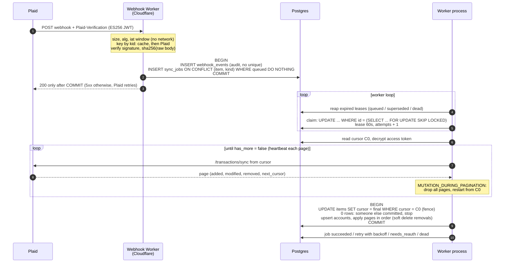

# plaid-sync-ledger

A small system that keeps a per-user ledger of bank transactions in sync with
Plaid, and stays correct when things fail halfway: duplicate and out-of-order
webhooks, workers killed mid-commit, concurrent workers, Plaid `500`s and
timeouts, and data that changes while it is being paginated.

It is an engineering demonstration, not a product. The UI is deliberately
minimal. What matters is the behaviour under failure, and every claim below
links to the test that proves it. The key tests were themselves checked by
breaking the code on purpose and watching them fail:
[`docs/mutation-checks.md`](docs/mutation-checks.md).

TypeScript monorepo (pnpm + Turborepo): Next.js 16 web app, a Cloudflare
Worker for webhooks, a Node worker consuming a Postgres-backed queue, Prisma
on PostgreSQL 17.

## What the system guarantees

| Guarantee | Proven by |
| --- | --- |
| A webhook gets `200` only after it is durably stored; if the write fails it gets `5xx`, so Plaid redelivers instead of the event being lost. | [`apps/webhooks/test/handler.test.ts`](apps/webhooks/test/handler.test.ts) |
| A webhook with a wrong algorithm, a stale or future `iat`, a bad signature, or a body changed by even one whitespace byte is rejected. | [`apps/webhooks/test/verify.test.ts`](apps/webhooks/test/verify.test.ts) |
| Forged JWTs with random key ids cannot be turned into a flood of calls to Plaid: unknown `kid`s are negative-cached. | [`verify.test.ts`](apps/webhooks/test/verify.test.ts), "negative-caches unknown kids" |
| Redelivered webhooks never cause duplicate work and never suppress a legitimate update: they coalesce into at most one queued job per Item. | [`ingest.test.ts`](apps/webhooks/test/ingest.test.ts), [`queue.test.ts`](packages/core/test/queue.test.ts), chaos `webhook-x10` |
| Applying a sync is idempotent: replaying the same update leaves the ledger byte-for-byte identical. | [`sync.test.ts`](packages/core/test/sync.test.ts), "is idempotent" |
| The new cursor is committed in the same transaction as the changes it covers; a crash at any point, while paginating or mid-commit, leaves both untouched. | [`sync.test.ts`](packages/core/test/sync.test.ts), "a crash mid-commit leaves both untouched", "a crash between page fetches", chaos `kill-mid-pagination`, `kill-mid-commit` |
| On `TRANSACTIONS_SYNC_MUTATION_DURING_PAGINATION`, every fetched page is discarded and the loop restarts from the cursor saved at its start. | [`sync.test.ts`](packages/core/test/sync.test.ts), chaos `mutation-page-2` |
| Two workers never both commit a sync for the same Item, and a stale worker cannot overwrite newer data, move the cursor back, or resurrect a removed transaction. | [`sync.test.ts`](packages/core/test/sync.test.ts), "fences out a concurrent run" / "a zombie" / "cannot resurrect", chaos `two-workers` |
| A job whose worker died is recovered by its expired lease; a job that keeps failing ends in a visible `dead` state after 5 attempts. | [`queue.test.ts`](packages/core/test/queue.test.ts), "reaper", "retries" |
| Transient Plaid failures (`500`, timeouts, rate limits) are retried with capped, full-jitter exponential backoff. | [`queue.test.ts`](packages/core/test/queue.test.ts), [`errors.test.ts`](packages/plaid/test/errors.test.ts), chaos `plaid-500`, `plaid-timeout` |
| `ITEM_LOGIN_REQUIRED` parks the Item in `needs_reauth` and requeues its job in one transaction, without burning a retry attempt; after repair, syncing resumes from the saved cursor, not from scratch. | [`queue.test.ts`](packages/core/test/queue.test.ts), "re-authentication", "parking for re-auth is atomic"; Sandbox: [`sandbox-contract-run.md`](docs/sandbox-contract-run.md) |
| Item webhooks cannot change Item state out of order, in either direction: they only trigger a fresh `/item/get`, and only the codes ADR 0005 names change state (a pending expiration does not stop syncing). | [`queue.test.ts`](packages/core/test/queue.test.ts), "a late ERROR" / "a late LOGIN_REPAIRED", [`errors.test.ts`](packages/plaid/test/errors.test.ts), [`ingest.test.ts`](apps/webhooks/test/ingest.test.ts) |
| Access tokens are never stored in plaintext, and a ciphertext copied to another row, column or user fails to decrypt. | [`packages/crypto/test/envelope.test.ts`](packages/crypto/test/envelope.test.ts) |
| The master key can be rotated while readers keep decrypting, without re-encrypting any token. | [`packages/core/test/rotation.test.ts`](packages/core/test/rotation.test.ts) |
| A user can only read their own Items, accounts and transactions, enforced by Postgres even for an unfiltered query. | [`packages/db/test/rls.test.ts`](packages/db/test/rls.test.ts) |
| Sessions cannot be forged or replayed after expiry, and state-changing routes reject cross-origin requests. | [`apps/web/test/session.test.ts`](apps/web/test/session.test.ts) |
| No access token, public token or marked PII reaches the logs, including on error paths. | [`no-secrets-in-logs.test.ts`](packages/core/test/no-secrets-in-logs.test.ts), every chaos scenario, ESLint `no-console` |
| Real Plaid credentials are only ever sent to Plaid: the fake target never reads them. | [`packages/plaid/test/config.test.ts`](packages/plaid/test/config.test.ts) |
| The Plaid adapter honours the same contract against the fake and against real Plaid Sandbox. | [`contract.test.ts`](packages/plaid/test/contract.test.ts), run against Sandbox: [`sandbox-contract-run.md`](docs/sandbox-contract-run.md) |
| Amounts never pass through a floating-point number between Plaid's JSON and `NUMERIC(19,4)`. | [`fake-behaviour.test.ts`](packages/plaid/test/fake-behaviour.test.ts), [`sync.test.ts`](packages/core/test/sync.test.ts) |
| The ledger produced by a clean run equals the provider's ground truth, and every chaos scenario produces that same ledger. | `pnpm chaos`, table below |

> **Deduplication is an optimization, not the correctness mechanism.**
> Plaid webhooks have no event id, and two legitimate `SYNC_UPDATES_AVAILABLE`
> for an Item can be byte-identical. A unique key on the body would drop real
> updates ([ADR 0001](docs/adr/0001-coalesce-sync-jobs-instead-of-permanent-webhook-dedup.md)).
> Correctness comes from the sync being idempotent and cursor-fenced. Running
> it more often than needed is harmless. Running it less often is not.

## From webhook to ledger



Three independent layers, each with one job:
**coalescing** avoids duplicate work, **leases** avoid two workers fetching the
same Item, and the **cursor compare-and-set** makes correctness hold even when
the first two fail ([ADR 0004](docs/adr/0004-job-leases-reaper-and-cursor-fencing.md)).

## Chaos results

`pnpm chaos` runs real processes for every scenario: the Plaid fake,
`wrangler dev` with the actual webhook Worker, and worker processes. Each
scenario gets a fresh database cloned from a migrated template. A scenario
passes only if its ledger hash equals the clean run, and the clean run must
equal an **oracle**: the fake's own ground truth, loaded into a separate
database and hashed by the same `ledger_hash()` SQL.

| Scenario | Fault injected | Result | Ledger hash | Sync runs | Superseded | Webhook deliveries | Kills | Time |
| --- | --- | --- | --- | ---: | ---: | ---: | ---: | ---: |
| `clean` | none (baseline) | PASS | `e99a82b6fd76` | 11 | 0 | 12 | 0 | 14s |
| `kill-mid-pagination` | SIGKILL after fetching page 2, before anything is written, 3 times, restart | PASS | `e99a82b6fd76` | 4 | 2 | 12 | 3 | 12s |
| `kill-mid-commit` | SIGKILL after 60 upserts inside the commit (FAIL_AFTER_N_UPSERTS), 3 times, restart | PASS | `e99a82b6fd76` | 5 | 2 | 12 | 3 | 13s |
| `webhook-x10` | every webhook delivered 10 times | PASS | `e99a82b6fd76` | 13 | 0 | 120 | 0 | 13s |
| `two-workers` | 2 worker processes + every webhook 3 times | PASS | `e99a82b6fd76` | 14 | 0 | 36 | 0 | 13s |
| `mutation-page-2` | MUTATION_DURING_PAGINATION on page 2 of every update | PASS | `e99a82b6fd76` | 11 | 0 | 12 | 0 | 12s |
| `plaid-500` | 30% of Plaid calls answer 500 | PASS | `e99a82b6fd76` | 7 | 0 | 12 | 0 | 13s |
| `plaid-timeout` | 30% of Plaid calls stall past the 1s client timeout | PASS | `e99a82b6fd76` | 3 | 3 | 12 | 0 | 26s |

Oracle hash: `e99a82b6fd76`. Run-to-run, the hash is fixed while sync-run counts
and timings vary with process scheduling, which is the point. Besides the hash, every row asserts that there
are no dead jobs, no running job with an expired lease, that every Item's
cursor equals Plaid's final cursor, that webhooks really went through the
Worker, that the injected fault was **observed** in the process output
(kills, reaps, restarts, retries, coalesced deliveries), and that no CANARY
token or PII value appears in any process output. Full output:
[`docs/chaos-results.md`](docs/chaos-results.md).

**Does the suite catch a real bug?** Yes. Committing the cursor in its own
statement before the records ([`docs/rca-001-repro.patch`](docs/rca-001-repro.patch))
still passes `clean`, but fails `kill-mid-commit` with hash `3467c3382ce3` and
85% of transactions silently missing. The write-up is in
[`docs/rca-001.md`](docs/rca-001.md).

## Decisions and what was left out

Each decision has an ADR in [`docs/adr/`](docs/adr), with the alternatives
that were rejected.

| ADR | Decision |
| --- | --- |
| [0001](docs/adr/0001-coalesce-sync-jobs-instead-of-permanent-webhook-dedup.md) | Coalesce into one queued job per Item instead of a permanent unique key on the webhook body, which would drop legitimate updates. |
| [0002](docs/adr/0002-worker-writes-directly-to-postgres.md) | The Worker writes to Postgres directly (Hyperdrive) with raw SQL, guarded by a test against the Prisma-migrated schema. |
| [0003](docs/adr/0003-sync-commits-all-pages-atomically.md) | Accumulate every page, then apply all of them and the cursor in one transaction. Removals are soft deletes. |
| [0004](docs/adr/0004-job-leases-reaper-and-cursor-fencing.md) | Lease + reaper for liveness, cursor compare-and-set as the correctness fence. |
| [0005](docs/adr/0005-item-state-from-item-get-not-webhook-order.md) | Item webhooks are hints. State comes from `/item/get`. `PENDING_*` does not stop syncing. |
| [0006](docs/adr/0006-envelope-encryption-with-bound-aad.md) | Envelope encryption, per-user DEK, AAD bound to row, column and user. Rotation re-wraps DEKs only. |
| [0007](docs/adr/0007-per-user-scoping-with-postgres-rls.md) | Per-user scoping by Postgres RLS with forced policies and separate roles. |
| [0008](docs/adr/0008-plaid-gateway-port-with-fake-and-sandbox.md) | A Plaid port with one HTTP adapter. A deterministic fake for chaos, one contract suite run against both the fake and real Sandbox. `PLAID_TARGET=fake\|sandbox` is the only switch, and real credentials never reach the fake. |
| [0009](docs/adr/0009-ledger-hash-definition.md) | The ledger hash: live rows only, JSON-encoded canonical lines, `C` collation, no wall-clock fields. |
| [0010](docs/adr/0010-chaos-harness-design.md) | Chaos with real processes, the real Worker under `wrangler dev`, and a database per scenario. |
| [0011](docs/adr/0011-minimal-signed-session-auth.md) | A minimal HMAC-signed session plus `Origin` checks instead of an auth library. |
| [0012](docs/adr/0012-webhook-verification-order-and-key-cache.md) | Verification order: cheap checks first, network last. Key cache by `kid` with negative caching. |
| [0013](docs/adr/0013-no-secrets-in-logs-allowlist-and-canary.md) | An allowlist logger and canary tests instead of redaction. |

**Where the original spec and Plaid's docs disagreed** (the docs won):

- `PENDING_EXPIRATION` only fires for European institutions. The US/CA
  equivalent is `PENDING_DISCONNECT`, and neither means the Item has stopped
  working, so neither stops syncing.
- `ITEM_LOGIN_REQUIRED` has no webhook of its own. It arrives as
  `ITEM` / `ERROR` with `error.error_code`.
- `removed` entries carry `account_id` as well as `transaction_id`.
- Plaid's own Node/Python/Ruby verification examples cache a single key and
  ignore `kid`, which breaks on key rotation. Keys are cached by `kid` here.
- The original dedup design (unique `item_id + code + body hash`) would have
  silently dropped legitimate updates. See ADR 0001.

**Schema changes on live data (bonus).** An expand/contract change on 5M rows
under concurrent writes, with measured lock impact: a plain `CREATE INDEX`
stalled writes for 4.28 s, while `CONCURRENTLY` never delayed a write by more
than 63 ms. `SET NOT NULL` via `CHECK ... NOT VALID` + `VALIDATE` kept the worst
write at 18 ms, against 1.31 s for the direct version. The same document records
how Prisma Migrate 7.10 actually behaves: migrations are not wrapped in a
transaction, so `CONCURRENTLY` works but a migration can be half applied. See
[`docs/migrations-on-live-data.md`](docs/migrations-on-live-data.md).

**Left out, on purpose:**

| What | Why |
| --- | --- |
| The Expo app, Stripe and SMS webhooks | They exercise the same ingestion pattern. One provider done properly says more than three done shallowly. |
| Real identity (passwords, OAuth, passkeys) | Not what this demonstrates. The session is still HMAC-signed and CSRF-checked, and RLS does not depend on it being clever (ADR 0011). |
| DEK rotation and a real KMS | Master-key rotation is implemented and tested. Rotating a single user's DEK means re-encrypting their fields, and is documented as the next step (ADR 0006). |
| Staging table for very large updates | Pages are accumulated in memory before the single commit. That is fine for typical updates; a staging table keyed by run id is the production answer (ADR 0003). |
| Compensation for an exchange that succeeds while the insert fails | The access token would be lost and the Plaid Item orphaned. Production would call `/item/remove` from an outbox. |
| Production reconciliation | A periodic comparison against a scratch-cursor sync would catch checkpoint bugs like RCA-001 in production, where there is no oracle. |
| A real Hyperdrive deployment | `wrangler dev` with `localConnectionString` runs the same code. The Hyperdrive id in `wrangler.jsonc` is a placeholder. |

## Where the AI got it wrong

This repository was built with an AI assistant. These are concrete bugs it
introduced, and how each was caught. The running log is in
[`docs/ai-errata.md`](docs/ai-errata.md). No entry is invented.

| # | What the assistant got wrong | Impact if shipped | How it was caught | Fix |
| --- | --- | --- | --- | --- |
| 1 | ADR 0009 defined the canonical ledger line as fields joined with `\|` and NULL rendered as `∅`. | Ambiguous encoding: a merchant name containing `\|` or `∅` lets two different ledgers produce the same hash, so the chaos suite could report a false PASS. | Assistant, while writing the SQL view: the separator choice could not survive a value containing the separator. | The line is now a `json_build_array(...)` per row (escaping, explicit `null`), ordered with `COLLATE "C"`. The ADR was amended in place. |
| 2 | ADRs 0003 and 0009 put soft-deleted rows in the ledger hash. | The hash depended on sync timing: a transaction added in one batch and removed in the next leaves a removed row only if a sync ran in between. Coalesced webhooks (ADR 0001) would make a correct ledger hash differently from the clean run, so the chaos suite would fail spuriously exactly in the scenarios it exists for. | Assistant, while writing the commit SQL and walking through the coalescing scenario against the fake's net-change semantics. | New migration: `ledger_lines` only covers `removed_at IS NULL`. ADRs 0003 and 0009 amended. |
| 3 | The first `serializeError()` accepted any string matching `[A-Za-z0-9_.:-]{1,80}` for `name`, `kind`, `errorCode` and `code`. | A string shaped like `access-sandbox-…` matches that pattern, so a token sitting in an error's `code` property would have been logged under `pg_code`. | Assistant, re-reading the logger right after its tests passed: the test only used a value with spaces, which the pattern rejected for the wrong reason. | Each field now has the exact shape of what it classifies (SQLSTATE is 5 uppercase alphanumerics, Plaid codes are `UPPER_SNAKE`). The test uses token-shaped values under every key. |
| 4 | The chaos harness released 3 later batches while the fake was started with its default of 4. | Every scenario waited for a batch that was never released and timed out, even though the ledger hash already matched the oracle. | The first `pnpm chaos clean` run timed out with all jobs `succeeded`. Logging the convergence predicate to `.chaos/harness.log` showed `unreleased: 3`. | The fake's batch count is passed from the same `LATER_BATCHES` constant the harness uses. |
| 5 | The scenario filter treated the `--` that `pnpm chaos` forwards as a scenario name. | `pnpm chaos` printed a green table with only the `clean` row: a passing chaos run that injected no chaos. | Assistant, reading the output table: one row where seven were expected. | `--` is dropped from argv. Each scenario row now also asserts that its fault actually happened (e.g. kills performed). |
| 6 | The 5M-row data generator computed amounts as `(g * 7919) % 100000` on the `int4` value from `generate_series`. | Integer overflow once `g` passes ~271k: the full run crashed after a 200k-row rehearsal had passed. | Running the demo at full size (`ERROR: integer out of range`, in `int4mul`). | `g::bigint * 7919`. |
| 7 | ADR 0003 said the soft delete stopped "a late upsert" from resurrecting a removed row, while the upsert (correctly) clears `removed_at`. | A reader would trust the wrong mechanism; anyone "fixing" the code to match the ADR would hide transactions Plaid reports as live. | Code review (spec axis): ADR text and `sync.ts` contradicted each other. | ADR amended: the guarantee is the cursor fence. New test builds the hazard (a zombie holding `added` for rows a newer sync removed) and shows 3 rows resurrect without the fence. |
| 8 | `refresh.ts` treated `PENDING_EXPIRATION` as login-required, and classified Plaid codes outside `packages/plaid`. | A consent-expiry warning would have parked a working Item and stopped its sync, contradicting ADR 0005 and the README. | Code review (spec and standards axes). | `classifyItemHealth()` in `packages/plaid/src/errors.ts`, mapping only the codes ADR 0005 names, with a table test. |
| 9 | Parking an Item for re-auth and requeueing its job ran as two statements, though ADR 0005 promised one transaction. | A crash between them left a half state: the Item parked while its job was still `running`, until the lease expired. | Code review (spec axis). | `parkForReauth()` does both in one transaction, retried once on a coalescing conflict (23505), with a test that forces the conflict. |
| 10 | The first version of the "late LOGIN_REPAIRED" test drained the whole queue before asserting. | A refresh that wrongly marked a broken Item healthy was hidden: the next sync re-parked the Item, so the test passed against a broken refresh. | Mutation check: making the refresh ignore `/item/get` did not fail the test. | The test runs only the refresh job (`processOne`) and asserts right after it. The same mutation now fails it. |
| 11 | The contract pagination test assumed the Sandbox Item had more than 50 transactions. | The suite could never pass against real Sandbox, which has exactly 50. | First run against real Sandbox. | The test paginates with `count: 10`. |
| 12 | The fake answered `transactions_update_status = HISTORICAL_UPDATE_COMPLETE` before any data existed. | A divergence from Sandbox, which answers `NOT_READY` until the initial pull lands. | Running the same contract test against both targets after making it wait for the historical pull. | The fake answers `NOT_READY` until its first batch is released. |
| 13 | The web app, worker and Worker built their Plaid client from `PLAID_BASE_URL` plus `PLAID_CLIENT_ID \|\| "fake-client-id"`. | As soon as real Sandbox credentials were added to `.env`, every app sent them to the local fake (and would have sent them to any host `PLAID_BASE_URL` pointed at). `pnpm dev` also broke. | Assistant, while checking the credentials the user had just added. | `PLAID_TARGET=fake\|sandbox` and a single `plaidConfigFromEnv()`: the fake target never reads the real credentials, and the fake URL must be local. Chaos forces the fake target. Unit-tested. |
| 14 | While fixing #9, the assistant claimed the atomic version meant "a crash between the two writes does not burn an attempt", and wrote that into the errata and a test name. | Overclaim: the attempt is counted at claim time, so any crash costs one (ADR 0004), atomic or not. What atomicity buys is no half state. | Second code review (spec axis): the test asserted `attempts: 1` on the crashed job. | Errata #9, ADR 0005 and the test names now state what is actually guaranteed. |
| 15 | The test for the 23505 retry in `parkForReauth` committed the concurrent insert before the UPDATE, so the existence check saw it and the retry path never ran. | The retry was untested: deleting it kept every test green. | Second code review (spec axis). | The test holds the concurrent insert uncommitted until the UPDATE blocks on the unique index. Deleting the retry now fails it. |

## Running it

Requirements: Node 24+, pnpm (via `corepack enable`), Docker.

```sh
pnpm install
cp .env.example .env              # then fill MASTER_KEYS (pnpm --filter @psl/crypto keygen) and SESSION_SECRET
cp apps/webhooks/.dev.vars.example apps/webhooks/.dev.vars
pnpm db:up && pnpm db:migrate && pnpm --filter @psl/db seed

pnpm dev                          # fake Plaid :4010, webhook Worker :8787, worker, web :3000

pnpm test                         # unit + integration tests against real Postgres and the fake over HTTP
pnpm chaos                        # all scenarios; or e.g. `pnpm chaos kill-mid-commit`
pnpm --filter @psl/plaid test:contract:sandbox   # contract suite against real Plaid Sandbox (needs PLAID_CLIENT_ID/SECRET)
# PLAID_TARGET=sandbox in .env runs the web app and worker against real Sandbox, with the Plaid Link UI
pnpm rotate-master-key --from 1 --to 2           # step 2 of the rotation runbook in ADR 0006
```

Layout:

```
apps/web        Next.js 16: login, Plaid Link, transaction list, API routes
apps/webhooks   Cloudflare Worker: verify -> persist -> 200
apps/worker     queue consumer process
packages/core   sync engine, queue, connect flow, re-auth, key rotation
packages/db     Prisma schema, migrations (RLS, roles, coalescing index, ledger view)
packages/plaid  Plaid port + fetch adapter + contract suite
packages/plaid-fake  deterministic Plaid fake with fault injection and signed webhooks
packages/crypto envelope encryption
packages/log    allowlist logger
tools/chaos     pnpm chaos
tools/ops       operational scripts
tools/migration-demo  expand/contract on 5M rows with measured lock impact
docs/           ADRs, RCA-001, chaos results, AI errata
```
